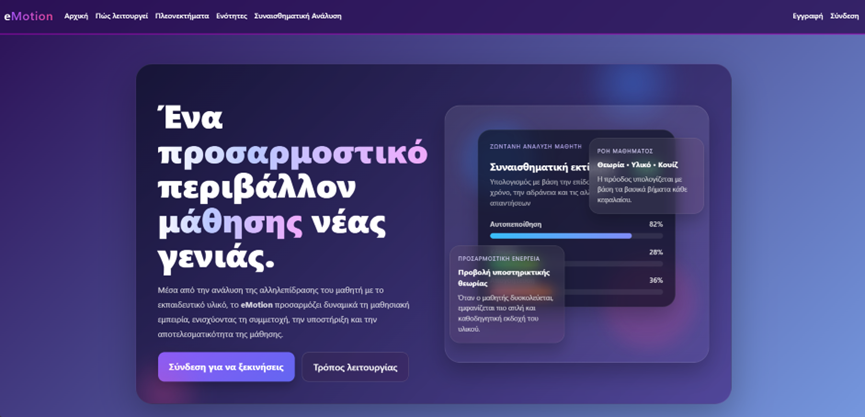
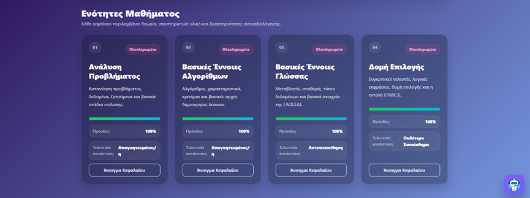
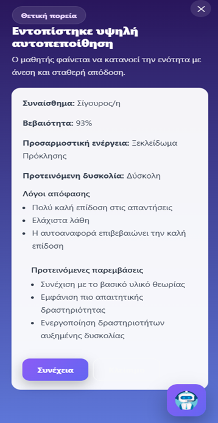
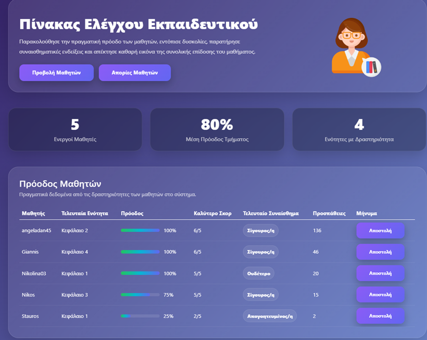
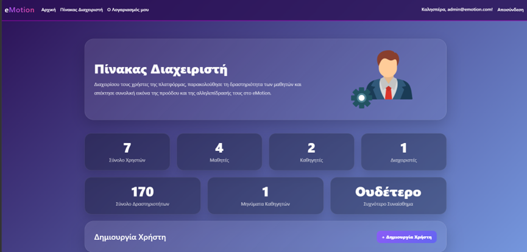

# eMotion — Emotion-Aware Adaptive Learning Platform

> Bachelor's thesis project · ASP.NET Core 8 MVC · Entity Framework Core · SQL Server

**eMotion** is a web-based learning platform that estimates a student's emotional state
(confident, anxious, frustrated, tired, idle) from the way they interact with the lessons,
and adapts the learning experience in real time: difficulty level, hints, summaries
and extra challenges.

The course content is an introductory programming course (algorithms, problem analysis,
pseudocode language basics, selection structures), written in Greek.

## Screenshots



### Course chapters with progress and last detected emotion


<table>
  <tr>
    <td width="32%" valign="top">
      <b>Live emotion analysis</b><br/>
      
    </td>
    <td width="68%" valign="top">
      <b>Teacher dashboard</b><br/>
      
    </td>
  </tr>
</table>

### Admin dashboard


---

## Features

### For students
- **4 interactive chapters** with theory, downloadable material and quizzes
- **Live emotion analysis** while studying: the UI changes mode (boost / support / calm / idle)
- **Self-reported emotion** that is combined with behavioural data
- **Progress page** with per-chapter scores and emotional history
- **Q&A with the teacher** for each chapter
- **Built-in study assistant chat**
- **E-mail reminders** if a student has been inactive for more than a day

### For teachers
- Dashboard with every student's progress, scores and detected emotional states
- Direct messages to students
- Reply to student questions

### For admin
- User management: create users, change roles, delete accounts

---

## How the emotion engine works

`Services/EmotionEngineService.cs` is a rule-based engine that analyses a `StudentActivity` record.

| Signal                         | Example rule                                |
|--------------------------------|---------------------------------------------|
| Score rate                     | ≥ 80% → high, < 50% → low                   |
| Idle time                      | ≥ 90 s → *Idle*                             |
| Quiz time                      | > 180 s → possible fatigue / struggle       |
| Answer changes                 | ≥ 4 → hesitation / anxiety                  |
| Wrong answers & attempts       | repeated failures → *Frustrated*            |
| Self-reported emotion          | raises or lowers the confidence of a result |

Each analysis returns:
- the **emotion** (`Confident`, `Anxious`, `Frustrated`, `Tired`, `Idle`, `Neutral`)
- a **confidence** score
- the recommended **difficulty** (`Easy` / `Medium` / `Hard`)
- a **support action** (`ShowHints`, `ShowSummary`, `UnlockChallenge`, `Continue`)
- the **reasons** behind the decision, so that the result is explainable to teachers

A background service (`InactiveStudentReminderService`) checks for inactive students
and sends them a reminder e-mail through MailKit.

---

## Tech stack

- **Backend:** C#, ASP.NET Core 8 MVC, Razor Pages
- **Auth:** ASP.NET Core Identity with roles (Student / Teacher / Admin)
- **Database:** Entity Framework Core (code-first migrations), SQL Server LocalDB
- **Frontend:** Razor views, Bootstrap 5, vanilla JavaScript, custom CSS
- **E-mail:** MailKit / MimeKit (SMTP)
- **Background jobs:** `BackgroundService` (hosted service)

## Project structure

```
eMotion/
├── Controllers/      # Student, Teacher, Admin, Lesson, Home, Account
├── Models/           # Entities & view models
├── Services/         # EmotionEngineService, EmailService, reminder background service
├── Data/             # ApplicationDbContext + EF Core migrations
├── Views/            # Razor views per role
├── Areas/Identity/   # Customised Identity pages (register / login)
└── wwwroot/          # CSS, JS, images, lesson material (PDF)
```

---

## Getting started

### Prerequisites
- [.NET 8 SDK](https://dotnet.microsoft.com/download)
- SQL Server LocalDB (included with Visual Studio) or any SQL Server instance

### Run locally

```bash
git clone https://github.com/atourgoutoglou/eMotion.git
cd eMotion/eMotion

dotnet tool install --global dotnet-ef   # if you don't have it
dotnet ef database update
dotnet run
```

Then open the URL shown in the terminal (e.g. `https://localhost:7212`).

### Demo accounts
An admin account is created automatically at first run:

| Role  | E-mail              | Password    |
|-------|---------------------|-------------|
| Admin | `admin@emotion.com` | `Admin123!` |

Students can register from the sign-up page. Teachers register with the teacher code
(`TEACHER123` by default, configurable in `Registration:TeacherSecretCode`).

> These are demo defaults for local development only. Override them in production.

### E-mail reminders (optional)
SMTP credentials are **not** stored in the repository. To enable e-mails, use
[User Secrets](https://learn.microsoft.com/aspnet/core/security/app-secrets):

```bash
dotnet user-secrets set "EmailSettings:SenderEmail" "you@gmail.com"
dotnet user-secrets set "EmailSettings:Username"    "you@gmail.com"
dotnet user-secrets set "EmailSettings:Password"    "<gmail-app-password>"
```

If these are not set, the app runs normally and simply skips sending e-mails.

---

## Notes
- PowerPoint versions of the lesson slides are not included because of their size;
  the PDF versions are in `wwwroot/files/`.
- The project was developed as my Bachelor's thesis.

## Author
**Alexandra Tourgoutoglou** · [LinkedIn](https://www.linkedin.com/in/alexandra-tourgoutoglou/) · [atourgoutoglou@gmail.com](mailto:atourgoutoglou@gmail.com)
